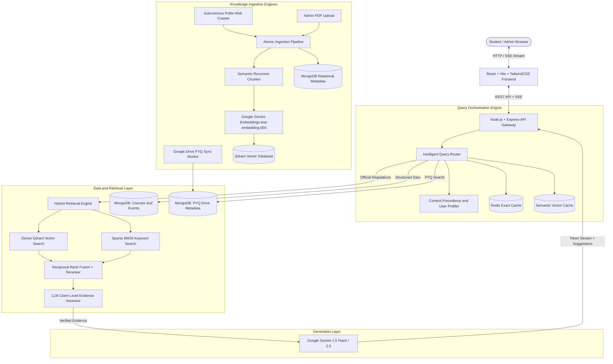
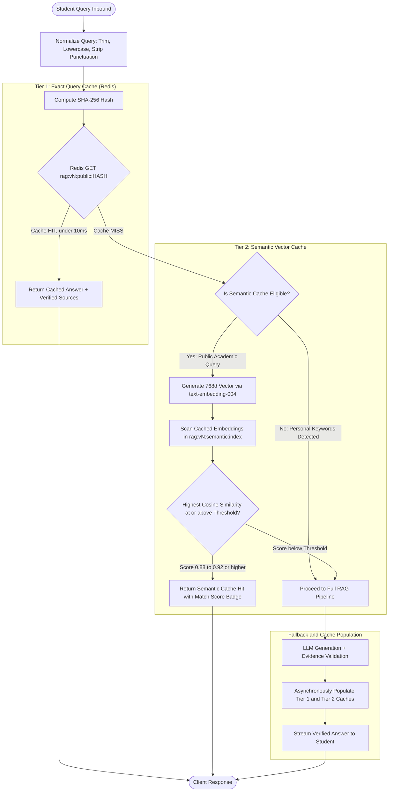

# 🎓 CampusGPT (AskCampusAi) — Comprehensive Architecture & Workflow Guide

> **An AI-powered, retrieval-augmented campus intelligence platform designed for NIT Kurukshetra students and faculty.**
> Built to eliminate academic information fragmentation by providing verified, instant answers to university regulations, course syllabi, exam schedules, and previous year question papers (PYQs).

---

## 📑 Table of Contents
1. [Platform Overview & Problem Statement](#1-platform-overview--problem-statement)
2. [High-Level System Architecture](#2-high-level-system-architecture)
3. [End-to-End Workflows & Algorithms](#3-end-to-end-workflows--algorithms)
   - [Workflow 1: Query Understanding & Intelligent Routing](#workflow-1-query-understanding--intelligent-routing)
   - [Workflow 2: Dual-Tier Caching (Exact + Semantic)](#workflow-2-dual-tier-caching-exact--semantic)
   - [Workflow 3: Hybrid Retrieval & Reciprocal Rank Fusion (RRF)](#workflow-3-hybrid-retrieval--reciprocal-rank-fusion-rrf)
   - [Workflow 4: Anti-Hallucination Evidence Assessment](#workflow-4-anti-hallucination-evidence-assessment)
   - [Workflow 5: Streaming Generation & Dynamic Follow-up Suggestions](#workflow-5-streaming-generation--dynamic-follow-up-suggestions)
   - [Workflow 6: Document Ingestion & Atomic Versioning](#workflow-6-document-ingestion--atomic-versioning)
   - [Workflow 7: Autonomous Polite Campus Web Crawler](#workflow-7-autonomous-polite-campus-web-crawler)
   - [Workflow 8: Community Google Drive PYQ Synchronization](#workflow-8-community-google-drive-pyq-synchronization)
   - [Workflow 9: Conversation Threads & Session Management](#workflow-9-conversation-threads--session-management)
   - [Workflow 10: Role-Based Access Control & User Personalization](#workflow-10-role-based-access-control--user-personalization)
4. [Technology Stack & Rationale ("Why Used")](#4-technology-stack--rationale-why-used)
5. [Repository Directory Structure](#5-repository-directory-structure)
6. [Environment Variables & Configuration](#6-environment-variables--configuration)
7. [Local Development & Execution](#7-local-development--execution)

---

## 1. Platform Overview & Problem Statement

### The Problem
In academic institutions like NIT Kurukshetra, vital student information is dispersed across multiple uncoordinated channels:
* Static PDF notices on departmental boards and web pages.
* Complex academic ordinances (attendance rules, condonation policies, grade credit systems).
* PYQs hosted across disparate student Google Drives.
* Course syllabus documents spread across varied departmental repositories.

Students frequently rely on rumors or spend hours hunting down specific clauses in 80-page ordinance PDFs.

### The Solution
**CampusGPT** acts as a centralized AI assistant that:
1. **Guarantees Truthfulness**: Answers exclusively based on official institute documents, verified web portals, and curated PYQs, refusing to hallucinate university policies.
2. **Context-Aware**: Understands student branch, semester, and degree program so queries like *"When is my mid-sem exam?"* resolve directly to the student's exact branch schedule without requiring repetitive clarification.
3. **Cites Sources Transparently**: Every factual statement is backed by clickable source badges pointing to the original PDF, page number, and paragraph.
4. **Supports Rich Responses**: Renders clean Markdown tables, formatted lists, and mathematical formulas via KaTeX.

---

## 2. High-Level System Architecture



---

## 3. End-to-End Workflows & Algorithms

### Workflow 1: Query Understanding & Intelligent Routing
* **Objective:** Direct each query to the optimal execution path (preventing heavy RAG searches for simple greetings or catalog queries).
* **Technique / Algorithm:**
  1. **Rule & Regex Pre-filtering:** Instantly captures greetings (`"hi"`, `"thank you"`), profile update requests (`"I am in 6th sem"`), and pure general computer science concepts (`"Explain QuickSort"`).
  2. **Entity Decomposition:** Extracts academic terms using a custom institute lexicon (`queryTerminology.js`) mapping synonyms (e.g., *"DBMS"* → *"Database Management Systems"*, *"PPO"* → *"Pre-Placement Offer"*, *"odd sem"* → Semesters 1, 3, 5, 7).
  3. **Context Precedence Resolution:**

     **Explicit Query Entity > Saved Student Profile > Recent Conversation Memory > Default Prompting**
  4. **Multi-Route Execution:**
     * `chat`: Instant friendly conversational response.
     * `general`: Direct Gemini general-knowledge response (no campus retrieval needed).
     * `hybrid`: Combines general concept explanation with campus syllabus lookup.
     * `clarification`: Prompts student when essential context is missing (e.g., asking for subject name when asking for PYQ).
     * `document_search`: High-speed MongoDB metadata query for question papers.
     * `structured`: Direct catalog query for course credits and prerequisites.
     * `rag`: Deep semantic vector + keyword search across university regulations.

---

### Workflow 2: Dual-Tier Caching (Exact + Semantic)

* **Objective:** Deliver **sub-50ms** responses for recurring campus inquiries (e.g., *"What is the minimum attendance requirement?"*, *"How many credits in 7th sem?"*) while slashing Google Gemini LLM API token consumption and eliminating redundant dense vector calculations.

#### Architecture Flowchart



> In the diagram, `vN` is the active cache version and `HASH` is the SHA-256 digest of the normalized query. The text below uses `{version}` and `{hash}`.

---

#### 1. Tier 1 — Exact Query Cache

* **Relevant Source Files:**
  * [`backend/src/services/cache/cacheKey.js`](backend/src/services/cache/cacheKey.js) — Normalization rules & SHA-256 hashing.
  * [`backend/src/services/cache/exactQueryCache.js`](backend/src/services/cache/exactQueryCache.js) — Redis lookup, storage, and hit/miss metric updates.
  * [`backend/src/services/cache/cacheService.js`](backend/src/services/cache/cacheService.js) — Resilient Redis command abstraction with automatic offline fallback.
  * [`backend/src/config/redis.js`](backend/src/config/redis.js) — Redis client connection & in-memory mock fallback.

* **Technique & Algorithm:**
  1. **Canonical Query Normalization (`normalizeQuery`):**
     * Strips leading and trailing whitespace.
     * Collapses duplicate whitespace sequences (`\s+`) into a single space.
     * Converts characters to lowercase.
     * Removes trailing terminal punctuation (`?`, `!`, `.`).

     Example:
     ```text
     "  What is the minimum attendance requirement???  "  →  "what is the minimum attendance requirement"
     ```
  2. **Deterministic Cryptographic Hashing (`hashQuery`):**
     * Computes the SHA-256 hex digest of the normalized string:

       $$\text{Hash} = \text{SHA-256}(\text{normalizedQuery})$$
  3. **Key Construction (`getExactCacheKey`):**
     * **Public Queries:** `rag:v{version}:public:{hash}`
     * **User-Scoped Queries:** `rag:v{version}:user:{userId}:{hash}`
  4. **Execution & TTL:**
     * Direct Redis `GET` execution completes in **under 10 ms**.
     * Entries are stored with a default TTL of 3600 seconds (1 hour, configurable via `RAG_CACHE_TTL_SECONDS`).
     * On hit, increments atomic Redis counter `metrics:rag:exact_hits`; on miss, increments `metrics:rag:exact_misses`.

---

#### 2. Tier 2 — Semantic Vector Cache

* **Relevant Source Files:**
  * [`backend/src/services/cache/semanticCache.js`](backend/src/services/cache/semanticCache.js) — Vector cosine similarity scanning, bounded index management, and FIFO eviction.
  * [`backend/src/services/ai/embeddingService.js`](backend/src/services/ai/embeddingService.js) — Google Gemini `text-embedding-004` (768 dimensions).
  * [`backend/src/services/cache/cacheKey.js`](backend/src/services/cache/cacheKey.js) — Privacy firewall guard (`isSemanticCacheEligible`).

* **Technique & Algorithm:**
  1. **Privacy Guardrail Firewall (`isSemanticCacheEligible`):**
     * Queries containing student-specific personal identifiers (*"my attendance"*, *"my cgpa"*, *"my fee balance"*, *"my marks"*, *"my password"*, *"my profile"*) or flagged as `isPrivate` are strictly disqualified from shared semantic caching to prevent cross-user data leakage.
  2. **Dense Vector Embedding:**
     * If the query misses Tier 1 and is eligible, it is converted into a 768-dimensional dense vector using Gemini's `text-embedding-004`.
  3. **Cosine Similarity Computation:**
     * Computes exact cosine similarity against all active cached query embeddings in the current version index (`rag:v{version}:semantic:index`):

       $$\text{Cosine Similarity}(A, B) = \frac{\mathbf{A} \cdot \mathbf{B}}{\|\mathbf{A}\|_2 \|\mathbf{B}\|_2} = \frac{\sum_{i=1}^{768} A_i B_i}{\sqrt{\sum_{i=1}^{768} A_i^2} \sqrt{\sum_{i=1}^{768} B_i^2}}$$
  4. **Configurable Similarity Threshold:**
     * Controlled via `SEMANTIC_CACHE_THRESHOLD` (defaults to **0.88** up to **0.92**).
     * If the best match achieves similarity ≥ threshold, the cached answer and verified sources are returned immediately with:
       ```json
       "cache": {
         "hit": true,
         "type": "semantic",
         "similarity": 0.9324,
         "threshold": 0.92,
         "matchedQuery": "what is attendance criteria"
       }
       ```
  5. **Bounded Memory & FIFO Eviction:**
     * Index size is capped by `SEMANTIC_CACHE_MAX_ENTRIES` (default: 100 entries per version).
     * When capacity is reached, the oldest entry is evicted (FIFO: `entries.shift()`).
     * Expired entries (`now > entry.expiresAt`) are lazily purged on every write.

---

#### 3. Cache Invalidation & Atomic Versioned Namespaces

* **Relevant Source Files:**
  * [`backend/src/services/cache/cacheInvalidation.js`](backend/src/services/cache/cacheInvalidation.js) — Atomic version counter bumping and active namespace resolution.
  * [`backend/src/routes/adminRoutes.js`](backend/src/routes/adminRoutes.js) — Administrative endpoints (`GET /api/admin/cache/stats`, `POST /api/admin/cache/invalidate`).
  * [`frontend/src/pages/AdminDashboard.jsx`](frontend/src/pages/AdminDashboard.jsx) — Live Redis hit-rate monitoring & one-click cache invalidation UI.

* **Technique & Algorithm:**
  1. **The Problem with Traditional `KEYS *` / `DEL` Flushes:**
     * Redis is single-threaded; running pattern scans across large key sets blocks network I/O and introduces severe latency spikes.
  2. **The Atomic Version Namespace Pattern:**
     * Redis key `rag:config:cache_version` holds an integer version number (e.g., `1`).
     * All exact and semantic cache keys are namespaced with the version:
       * `rag:v1:public:<hash>`
       * `rag:v1:semantic:index`
     * When any knowledge update occurs, the system executes an atomic increment on the version key:

       $$\text{INCR}(v_1) \longrightarrow v_2$$
     * All subsequent reads and writes immediately target `rag:v2:...` in **O(1)** time (under 1 ms).
     * Stale `v1` keys naturally expire according to their TTLs with zero blocking overhead.

* **Automated Invalidation Triggers Across the Platform:**

  | Event / Action | Source File | Trigger Call |
  |---|---|---|
  | **Admin PDF Upload / Re-index** | [`ingestionService.js`](backend/src/services/ingestion/ingestionService.js) | `cacheInvalidation.incrementCacheVersion("Document Ingested: ...")` |
  | **Document Deletion / Approval** | [`documentController.js`](backend/src/controllers/documentController.js) | `cacheInvalidation.incrementCacheVersion("Document Deleted: ...")` |
  | **Web Crawler HTML Page Ingestion** | [`crawlerEngine.js`](backend/src/services/crawler/crawlerEngine.js) | `cacheInvalidation.incrementCacheVersion("HTML Page Indexed: ...")` |
  | **Academic Calendar / Circular Updates** | [`academicEventService.js`](backend/src/services/events/academicEventService.js) | `cacheInvalidation.incrementCacheVersion("Academic Event: ...")` |
  | **Course Curriculum / Syllabus Updates** | [`courseService.js`](backend/src/services/courses/courseService.js) | `cacheInvalidation.incrementCacheVersion("Course Created/Updated: ...")` |
  | **Manual Admin Dashboard Flush** | [`adminRoutes.js`](backend/src/routes/adminRoutes.js) | `POST /api/admin/cache/invalidate` → `cacheInvalidation.invalidateRagCache()` |

---

#### 4. End-to-End Orchestration in RAG Pipeline

* **Primary Coordinator:** [`backend/src/services/rag/ragService.js`](backend/src/services/rag/ragService.js)
  * **Lines 197–233:** Resolves active cache version → Queries Tier 1 `exactQueryCache.get()`. If hit, streams tokens, emits verified sources, and exits immediately (under 10 ms).
  * **Lines 238–265:** If Tier 1 misses, validates `isSemanticCacheEligible()` → Queries Tier 2 `semanticCache.findSimilar()`. If cosine similarity ≥ threshold, streams tokens with the semantic similarity score and exits (under 50 ms).
  * **Lines 267–444:** If both tiers miss, executes dense vector search + BM25 keyword retrieval + Reciprocal Rank Fusion + Claim Evidence Assessment + Gemini LLM generation.
  * **Lines 446–463:** Upon successful answer generation, writes asynchronously to **both** `exactQueryCache.set()` and `semanticCache.store()` for subsequent requests.

---

### Workflow 3: Hybrid Retrieval & Reciprocal Rank Fusion (RRF)
* **Objective:** Retrieve the most relevant chunks from hundreds of PDF pages without missing exact rule numbers or semantic meaning.
* **Technique / Algorithm:**
  1. **Dense Vector Retrieval (Semantic):**
     * Query is converted to vector embedding via `text-embedding-004`.
     * Searched in **Qdrant** with Cosine Distance. Finds conceptually related paragraphs even if exact terms differ.
  2. **Sparse Keyword Retrieval (Lexical / BM25):**
     * Tokenizes query and runs exact matching against indexed chunk keywords, document numbers, and rule codes (e.g., `"Rule 4.2.1"` or `"B.Tech Ordinance"`).
  3. **Reciprocal Rank Fusion (RRF):**
     * Blends the ranked lists from both vector search and keyword search without needing normalized scores:

       $$RRF(d) = \sum_{m \in M} \frac{1}{k + r_m(d)}$$

       *(where k = 60, M = {dense, sparse}, and r_m(d) is the rank of document d in system m)*.
  4. **Heuristic Reranking:**
     * Applies domain-specific weighting boosts:
       * **Source Authority:** Official university regulations receive higher weight than student drive notes.
       * **Recency:** Newer academic calendar years receive a time-decay boost.
       * **Entity Match:** Chunks matching the student's department and semester receive extra weight.

---

### Workflow 4: Anti-Hallucination Evidence Assessment
* **Objective:** Ensure the LLM never fabricates non-existent campus rules or misleading statistics.
* **Technique / Algorithm:**
  1. **Claim Extraction:** The system decomposes the student inquiry into 1 to 4 core factual claims.
  2. **LLM-as-a-Judge Verification:** Before generating the final response, an isolated prompt evaluates the retrieved context against the extracted claims:
     * Does the text contain concrete rules, guidelines, or procedures for this claim?
     * Marks coverage as `FULL`, `PARTIAL`, or `INSUFFICIENT`.
  3. **Dynamic Query Expansion (Retry Loop):**
     * If coverage is `INSUFFICIENT`, the system reformulates the query with domain synonyms (e.g., adding *"condonation"*, *"medical leave"*) and executes an expanded retrieval pass.
  4. **Strict Refusal Guardrail:**
     * If retrieved context genuinely lacks evidence, the system returns a polite, transparent fallback:
       > *"I couldn't find this information in the available official university documents."*
     * This guarantees that false statements are never presented to students.

---

### Workflow 5: Streaming Generation & Dynamic Follow-up Suggestions
* **Objective:** Deliver low-latency user experience with animated token streaming, formatted source citations, and interactive follow-up buttons.
* **Technique / Algorithm:**
  1. **Server-Sent Events (SSE):**
     * A persistent HTTP connection (`text/event-stream`) emits real-time event packets:
       * `event: connected` (emits conversation ID and session state).
       * `event: status` (updates user UI: *"Searching academic records..."*).
       * `event: sources` (emits structured citation cards before answer generation).
       * `event: token` (streams raw words/tokens as Gemini generates them).
       * `event: done` (signals stream completion).
  2. **Token Buffering & Suggestion Masking:**
     * Gemini is prompted to append 2–3 contextual follow-up questions wrapped in `[SUGGESTIONS: "...", "..."]`.
     * A `StreamingTokenFilter` intercepts stream chunks, buffering potential suggestion tags so raw bracket syntax never leaks to the student's chat bubble.
     * On stream end, suggestions are parsed and rendered as clickable chip buttons under the message.
  3. **Auto-Titling Turn 1:**
     * After the first user message, an asynchronous background task calls Gemini to summarize the query into a 2–4 word title (e.g., *"DBMS Exam Guidelines"*) and updates the sidebar thread title.

---

### Workflow 6: Document Ingestion & Atomic Versioning
* **Objective:** Process uploaded campus PDFs into high-quality vector embeddings with zero downtime or stale search results during updates.
* **Technique / Algorithm:**
  1. **Physical Validation & SHA-256 Hashing:**
     * Verifies file magic bytes, MIME type (`application/pdf`), and maximum file size (50MB).
     * Calculates cryptographic SHA-256 hash to detect exact duplicate uploads.
  2. **Text Extraction & Cleaning:**
     * Uses `pdf-parse` to extract text page by page.
     * Strips repeated header/footer watermarks, normalizes whitespace, and fixes broken ligatures.
  3. **Recursive Semantic Sliding-Window Chunking:**
     * Breaks text into 500–1000 character windows with a 150-character sliding overlap.
     * Splits cleanly along paragraph and sentence boundaries rather than cutting words in half.
  4. **Batch Vector Embedding:**
     * Generates 768-dimensional embeddings in batches via Google Gemini.
     * Upserts points into Qdrant vector database tagged with metadata: `documentId`, `versionId`, `category`, `department`, `pageNumber`, and `isActive: false`.
  5. **Atomic Version Switch:**
     * Once all chunks are indexed in Qdrant, MongoDB updates `isActive: true` on the new `DocumentVersion` and flips the old version to inactive.
     * Prevents partial indexing states where searchers see half of a new document and half of an old document.

---

### Workflow 7: Autonomous Polite Campus Web Crawler
* **Objective:** Periodically discover and ingest newly published notifications, exam schedules, and circulars from `nitkkr.ac.in`.
* **Technique / Algorithm:**
  1. **Robots.txt Parser & Politeness Engine:**
     * Checks `robots.txt` compliance before crawling.
     * Enforces polite rate limiting (1.5s delay between requests to avoid stressing university servers).
  2. **Breadth-First Search (BFS) Frontier:**
     * Discovers links starting from seed URLs.
     * Whitelist restriction strictly enforces `*.nitkkr.ac.in` domain boundaries.
  3. **Content Extraction:**
     * Uses **Cheerio** to isolate main content articles (`<main>`, `<article>`, `.content`) and strip sidebars, navigation headers, and footers.
  4. **PDF Inspection:**
     * Discovers hyperlinks pointing to `.pdf` files, fetches HTTP headers to verify content length, downloads the files, and routes them to the ingestion pipeline.

---

### Workflow 8: Community Google Drive PYQ Synchronization
* **Objective:** Index thousands of previous year exam papers stored in public Google Drive student folders.
* **Technique / Algorithm:**
  1. **Google Drive API v3 Integration:**
     * Authenticates with service credentials to scan designated public community folders.
  2. **Hierarchical Path Metadata Extractor:**
     * Analyzes folder naming conventions to infer academic metadata automatically:

       ```text
       Folder: /B.Tech/Computer Engineering/Semester 4/2023/
         → Program  = B.Tech
         → Branch   = Computer Engineering
         → Semester = 4
         → Year     = 2023
       ```
  3. **Question-Level Extraction:**
     * Where possible, individual questions, marks allocations, and exam types (Mid-Sem / End-Sem) are extracted into structured MongoDB `PyqDocument` records for question-specific retrieval.

---

### Workflow 9: Conversation Threads & Session Management
* **Objective:** Give students a ChatGPT-style sidebar where they can organize different study topics without context pollution.
* **Technique / Algorithm:**
  1. **Thread Data Model:**
     * Stored in MongoDB `Conversation` model with `userId`, `title`, `pinned`, `summary`, and `updatedAt`.
  2. **Message Partitioning:**
     * Every `ChatMessage` is keyed by `conversationId`. Selecting a chat thread fetches strictly its own history, preventing messages from bleeding across conversations.
  3. **Session Features:**
     * Create new chat thread.
     * Pin important chats to the top of the sidebar.
     * Inline renaming of chat titles.
     * Cascade deletion (deleting a conversation removes all associated chat messages).

---

### Workflow 10: Role-Based Access Control & User Personalization
* **Objective:** Protect administrative operations while tailoring assistant answers to each student's academic path.
* **Technique / Algorithm:**
  1. **JWT Authentication:**
     * Cryptographically signed JSON Web Tokens (stored in `localStorage` and sent via `Authorization: Bearer <token>` headers).
     * Passwords hashed using **bcryptjs** with salt rounds of 10.
  2. **Role Separation:**
     * `student`: Standard access to chat, documents catalog, course catalog, notices, and personal profile.
     * `admin`: Access to `/admin` dashboard to control web crawlers, manage document ingestion, trigger Drive syncs, and inspect RAG retrieval diagnostics.
  3. **Profile-Driven Resolution:**
     * When a student asks: *"Do I need to submit attendance condonation?"*, the system checks their stored `semester` and `branch` to reference the exact ordinance applicable to their year.

---

## 4. Technology Stack & Rationale ("Why Used")

| Layer | Technology | Why This Technology Was Chosen |
|---|---|---|
| **Frontend Framework** | **React 18 + Vite** | Extremely fast Hot Module Replacement (HMR), lightweight build size, and React's component state model is ideal for streaming chat UIs. |
| **Styling & Design** | **TailwindCSS** | Utility-first CSS allowing complete control over a sleek, dark-mode glassmorphic interface inspired by ChatGPT. |
| **Icons & Typography** | **Lucide React + Inter Font** | Clean, minimalist, modern iconography that loads as tree-shakeable SVG components. |
| **Markdown & Math** | **react-markdown, remark-math, rehype-katex** | Allows the AI to render rich academic answers including syllabus tables, code blocks, and complex mathematical formulas cleanly in the browser. |
| **Backend Runtime** | **Node.js (ES Modules)** | Asynchronous non-blocking event loop ideal for handling concurrent streaming connections (SSE) and fast REST APIs. |
| **Web Server Framework** | **Express.js** | Industry standard, flexible routing middleware with security headers configured via `helmet` and custom `cors`. |
| **Relational / Metadata DB** | **MongoDB (Mongoose ODM)** | Flexible document schema ideal for varying document structures (course catalogs, user profiles, crawl job logs, and chat messages). |
| **Vector Database** | **Qdrant** | High-performance vector database with native support for payload filtering (filtering chunks by `department`, `semester`, and `versionId` alongside vector search). |
| **In-Memory Cache** | **Redis** | Sub-millisecond latency for exact query caching, session locks, and rate-limiting counters. Features graceful in-memory fallback if Redis is offline. |
| **LLM & Embeddings** | **Google Gemini 1.5 Flash & text-embedding-004** | Fast token generation speed, high context window (up to 1M tokens), competitive pricing, and 768-dimension semantic embeddings. |
| **File Parser** | **pdf-parse** | Lightweight server-side PDF text extraction without requiring external binary dependencies like Poppler or Java. |
| **Web Scraping** | **Cheerio** | Extremely fast jQuery-like DOM manipulation in memory for parsing HTML pages fetched by the polite crawler. |
| **Security & Auth** | **JWT (jsonwebtoken) + bcryptjs** | Stateless token authentication that scales easily across distributed deployments without server session state. |

---

## 5. Repository Directory Structure

```text
AskCampusAi/
├── backend/                             # Express.js REST API & AI Pipelines
│   ├── src/
│   │   ├── config/                      # Database & cache configurations
│   │   │   ├── db.js                    # MongoDB connection
│   │   │   └── redis.js                 # Redis client with graceful fallback
│   │   ├── controllers/                 # Route controllers
│   │   │   ├── adminCourseController.js    # Course catalog management
│   │   │   ├── adminCrawlerController.js   # Crawler jobs & source control
│   │   │   ├── adminDocumentController.js  # Document ingestion & versioning
│   │   │   ├── adminKnowledgeController.js # High-level admin analytics
│   │   │   ├── authController.js           # Student & Admin authentication
│   │   │   ├── chatController.js           # Chat sessions & SSE message handler
│   │   │   ├── conversationController.js   # Conversation threads CRUD
│   │   │   └── documentController.js       # Student document explorer API
│   │   ├── middleware/                  # Express middleware
│   │   │   ├── authMiddleware.js        # JWT verification & Admin guards
│   │   │   ├── errorMiddleware.js       # Centralized 404 & 500 error handlers
│   │   │   ├── rateLimiter.js           # Express IP & user rate limiting
│   │   │   └── uploadMiddleware.js      # Multer file upload storage
│   │   ├── models/                      # Mongoose data schemas
│   │   │   ├── AcademicEvent.js         # Important dates & deadlines
│   │   │   ├── ChatMessage.js           # Messages & token statistics
│   │   │   ├── Chunk.js                 # Text chunks & embedding IDs
│   │   │   ├── Conversation.js          # Chat threads & pinned status
│   │   │   ├── Course.js                # Course syllabi & credits
│   │   │   ├── CrawlJob.js              # Web crawl run logs
│   │   │   ├── CrawlUrl.js              # Crawl URL frontier records
│   │   │   ├── Document.js              # Academic documents
│   │   │   ├── DocumentVersion.js       # Version tracking & staging
│   │   │   ├── IngestionJob.js          # Document processing stages
│   │   │   ├── PyqDocument.js           # Previous year question papers
│   │   │   ├── PyqSyncJob.js            # Drive sync job logs
│   │   │   ├── User.js                  # User accounts & academic profile
│   │   │   └── WebsiteSource.js         # Registered crawler target domains
│   │   ├── routes/                      # API endpoint definitions
│   │   ├── services/                    # Core business logic
│   │   │   ├── ai/                      # Gemini LLM & embedding callers
│   │   │   ├── cache/                   # Exact & semantic query caching
│   │   │   ├── courses/                 # Course catalog queries
│   │   │   ├── crawler/                 # Polite autonomous web scraper
│   │   │   ├── documents/               # PDF parsing, cleaning & chunking
│   │   │   ├── drive/                   # Google Drive API sync
│   │   │   ├── ingestion/               # Atomic versioning & file validation
│   │   │   ├── pyq/                     # PYQ processing & question indexing
│   │   │   ├── query/                   # Query router, understanding & lexicon
│   │   │   ├── rag/                     # RAG orchestrator & evidence assessor
│   │   │   ├── retrieval/               # Vector, BM25 & RRF hybrid search
│   │   │   └── vector/                  # Qdrant client & point upserting
│   │   ├── app.js                       # Express app configuration & middleware
│   │   └── server.js                    # Server startup & DNS resolution
│   └── package.json
│
├── frontend/                            # React SPA User Interface
│   ├── public/                          # Static assets & redirects
│   ├── src/
│   │   ├── components/                  # Reusable UI components
│   │   │   ├── admin/                   # Admin portal components
│   │   │   │   ├── CrawlerManagement.jsx   # Web crawler live monitor
│   │   │   │   ├── DiagnosticsTab.jsx      # Interactive RAG debugger
│   │   │   │   └── KnowledgeManagement.jsx # Document & PYQ sync portal
│   │   │   ├── ErrorBoundary.jsx        # React UI error boundary
│   │   │   ├── ProtectedRoute.jsx       # Auth guard wrapper
│   │   │   └── Sidebar.jsx              # ChatGPT-style chat thread manager
│   │   ├── context/                     # Global state providers
│   │   │   ├── AuthContext.jsx          # Login, logout & user profile state
│   │   │   └── ChatContext.jsx          # Active chat session, threads & CRUD
│   │   ├── pages/                       # Route pages
│   │   │   ├── AdminDashboard.jsx       # Consolidated admin dashboard
│   │   │   ├── Assistant.jsx            # Real-time streaming campus assistant
│   │   │   ├── Courses.jsx              # Course catalog search & explorer
│   │   │   ├── Dashboard.jsx            # Student dashboard overview
│   │   │   ├── Documents.jsx            # University documents repository
│   │   │   ├── Login.jsx                # Student/Admin sign in
│   │   │   ├── Notices.jsx              # Institute circulars & deadlines
│   │   │   ├── Profile.jsx              # Student academic profile settings
│   │   │   └── Register.jsx             # Student account registration
│   │   ├── services/                    # API client layer
│   │   │   └── api.js                   # Axios & SSE fetch wrappers
│   │   ├── App.jsx                      # App route definitions & layouts
│   │   ├── index.css                    # Tailwind CSS directives & theme tokens
│   │   └── main.jsx                     # Vite React entrypoint
│   └── package.json
│
└── README.md                            # Complete Project Documentation
```

---

## 6. Environment Variables & Configuration

### Backend (`backend/.env`)
```bash
# Server Port & Environment
PORT=5000
NODE_ENV=development
CLIENT_URL=http://localhost:5173

# Database Connection (MongoDB)
MONGODB_URI=mongodb+srv://<username>:<password>@cluster.mongodb.net/askcampusai?retryWrites=true&w=majority

# JWT Authentication
JWT_SECRET=your_super_secret_jwt_key_here
JWT_EXPIRE=30d

# Google Gemini AI API
GEMINI_API_KEY=your_gemini_api_key_here
GEMINI_MODEL=gemini-1.5-flash
EMBEDDING_MODEL=text-embedding-004

# Qdrant Vector Database
QDRANT_URL=https://<your-cluster>.qdrant.tech:6333
QDRANT_API_KEY=your_qdrant_api_key_here
QDRANT_COLLECTION=campus_knowledge

# Redis Caching
REDIS_URL=redis://default:<password>@<host>:<port>

# RAG Pipeline Thresholds
RAG_TOP_K=6
RAG_MIN_SCORE=0.45
```

### Frontend (`frontend/.env`)
```bash
VITE_API_URL=http://localhost:5000/api
```

---

## 7. Local Development & Execution

### Prerequisites
* **Node.js** v18+ installed
* **MongoDB** (Local instance or free MongoDB Atlas cluster)
* **Qdrant** (Local Docker container or free Qdrant Cloud cluster)
* **Redis** (Optional — local server, Redis Cloud, or automated graceful in-memory fallback)
* **Google Gemini API Key** (from [Google AI Studio](https://aistudio.google.com/))

### Installation Steps

1. **Clone the Repository:**
   ```bash
   git clone <repo-url>
   cd AskCampusAi
   ```

2. **Setup Backend:**
   ```bash
   cd backend
   npm install
   # Create .env based on the template above
   npm run dev
   ```
   *The backend starts at `http://localhost:5000`.*
   *Health Check endpoint: `http://localhost:5000/api/health`.*

3. **Setup Frontend:**
   ```bash
   cd ../frontend
   npm install
   # Create .env based on the template above
   npm run dev
   ```
   *The frontend starts at `http://localhost:5173`.*

4. **Access the Application:**
   * Open `http://localhost:5173` in your browser.
   * Register a student account or log in with an administrator account to explore the knowledge crawler and RAG diagnostics dashboard.

---

## 📜 License & Acknowledgments
Developed with pride for the student and faculty community of **National Institute of Technology, Kurukshetra**.
Powered by Google Gemini AI, Qdrant Vector Search, and the open-source web ecosystem.
