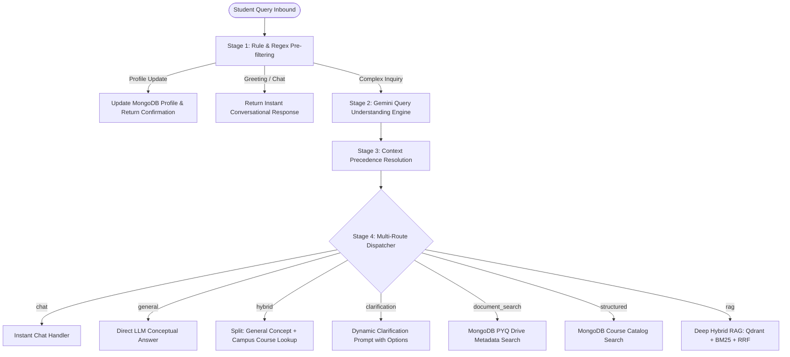

# 🧭 Workflow 1: Query Understanding & Intelligent Routing

> **CampusGPT / AskCampusAi Architectural Guide**  
> A concise, code-navigable breakdown of the Intent Classification, Context Precedence Hierarchy, and Multi-Route Execution Engine with top interview questions.

---

## 1. Objective & Why It Matters

### The Core Problem
Sending **every user query directly to a full RAG pipeline** is an anti-pattern:
* Greetings (*"Hi"*, *"Thank you"*) or conceptual questions (*"Explain QuickSort"*, *"What is PCA?"*) do not exist in university policy PDFs.
* Running vector search + BM25 on such queries causes **retrieval noise, latency penalties (2s+), and wasted LLM token costs**.

### The Solution
Workflow 1 acts as the **traffic controller (orchestrator)**. It inspects query intent, extracts academic entities, resolves user context, and routes the request to the lightest and most accurate handler:
* **Greetings & Chat:** 0ms retrieval, instant response.
* **General CS / Coding:** Bypasses campus retrieval, calls Gemini directly.
* **PYQs / Courses:** Fast MongoDB metadata lookup (< 50ms).
* **Official Policies:** Full Hybrid RAG (Qdrant + BM25 + Evidence Assessor).

---

## 2. The 4-Stage Routing Architecture

### Stage 1: Rule & Regex Pre-filtering
* **Profile Updates:** Intercepts profile changes (e.g., *"I am in 6th sem now"*, *"My branch is ECE"*) via [`userContextService.js`](file:///d:/CODING/WEB%20DEV/Projects/AskCampusAi/backend/src/services/query/userContextService.js#L123-L159). It updates MongoDB immediately and skips retrieval.
* **Trivial Chat:** Instantly handles greetings (`"hi"`, `"hello"`, `"thanks"`) without hitting any LLM.

### Stage 2: Dynamic Query Understanding ([`queryUnderstandingService.js`](file:///d:/CODING/WEB%20DEV/Projects/AskCampusAi/backend/src/services/query/queryUnderstandingService.js))
Uses Gemini with a structured JSON schema (`temperature: 0.1`) to extract:
* **`intent`**: e.g., `PYQ_SEARCH`, `ATTENDANCE_REGULATION`, `COURSE_CATALOG`, `GENERAL_CONCEPT`.
* **`queryType`**: `rag` | `general` | `hybrid` | `structured` | `clarification` | `chat`.
* **`entities`**: Subject, courseCode, branch, semester, examType, academicYear.
* **`rewrittenQuery` & `expandedTerms`**: Normalizes campus slang (e.g., *"MSE"* $\rightarrow$ *"Mid Semester Exam"*, *"PPO"* $\rightarrow$ *"Pre-Placement Offer"* via [`queryTerminology.js`](file:///d:/CODING/WEB%20DEV/Projects/AskCampusAi/backend/src/services/query/queryTerminology.js)).

### Stage 3: Strict Context Precedence Resolution ([`userContextService.js`](file:///d:/CODING/WEB%20DEV/Projects/AskCampusAi/backend/src/services/query/userContextService.js#L19-L105))
Resolves missing query details using a strict hierarchy so students don't have to repeat their branch/semester every turn:
$$\mathbf{\text{Explicit Query Entity}} > \mathbf{\text{Recent Conversation Memory}} > \mathbf{\text{Stored User Profile}} > \mathbf{\text{Unknown / Fallback}}$$

* *Example:* If a CSE student asks *"Show me 5th sem datesheet for ECE"*, the explicit entity `ECE` overrides their stored profile `CSE`.

### Stage 4: Multi-Route Dispatcher ([`queryRouter.js`](file:///d:/CODING/WEB%20DEV/Projects/AskCampusAi/backend/src/services/query/queryRouter.js#L210-L460))

| Route | Trigger Example | What It Does | Latency |
|---|---|---|---|
| **`chat`** | *"Hi"*, *"Thank you"* | Returns conversational message; 0 DB / 0 LLM calls. | **< 5ms** |
| **`general`** | *"Explain QuickSort"*, *"What is PCA?"* | Answers via Gemini general knowledge; 0 campus retrieval. | **~500ms** |
| **`hybrid`** | *"Explain DBMS and courses offered at NIT KKR"* | Splits query: Gemini explains theory + DB searches syllabus. | **~1,200ms** |
| **`clarification`** | *"Give me question papers"* (no subject) | Prompts for missing subject with clickable options. | **< 50ms** |
| **`document_search`** | *"DBMS 2024 PYQ"*, *"Download paper"* | Queries MongoDB PYQ metadata; returns direct PDF link. | **~40ms** |
| **`structured`** | *"Prerequisites for CS301"*, *"Credits in 7th sem"* | Direct MongoDB query on Course collection. | **~30ms** |
| **`rag`** | *"What is the attendance condonation policy?"* | Full hybrid RAG: Qdrant + BM25 + Evidence Assessor. | **~1.8s** |

---

## 3. Code Navigation Map

| Responsibility | File Path | Key Functions / Exports |
|---|---|---|
| **Dynamic Understanding** | [`backend/src/services/query/queryUnderstandingService.js`](file:///d:/CODING/WEB%20DEV/Projects/AskCampusAi/backend/src/services/query/queryUnderstandingService.js) | `understandQuery()` |
| **Master Route Orchestrator** | [`backend/src/services/query/queryRouter.js`](file:///d:/CODING/WEB%20DEV/Projects/AskCampusAi/backend/src/services/query/queryRouter.js) | `routeQuery()` |
| **User Context & Profile** | [`backend/src/services/query/userContextService.js`](file:///d:/CODING/WEB%20DEV/Projects/AskCampusAi/backend/src/services/query/userContextService.js) | `resolveUserContext()`, `detectProfileUpdateRequest()` |
| **Terminology Dictionaries** | [`backend/src/services/query/queryTerminology.js`](file:///d:/CODING/WEB%20DEV/Projects/AskCampusAi/backend/src/services/query/queryTerminology.js) | `normalizeUniversityTerms()`, `UNIVERSITY_TERM_MAP` |

---

## 4. Top Interview Questions & Expert Answers

### Q1: Why use an Intelligent Query Router instead of sending everything directly to RAG?
> **Answer:**  
> In production, over 40% of queries do not require document retrieval (e.g., greetings, general programming questions, course catalog queries). Sending them through RAG adds **1.5s+ of unnecessary latency**, floods the vector database, and introduces hallucination risks where the LLM tries to force an answer out of unrelated policy PDFs. A router delivers **sub-50ms responses** for structured/metadata queries and cuts LLM API token consumption significantly.

### Q2: What happens if a student's question conflicts with their profile (e.g., a CSE student asks about Civil Engineering)?
> **Answer:**  
> The system implements a **Context Precedence Hierarchy**:
> $$\text{Explicit Query Entity} > \text{Recent Conversation Memory} > \text{Stored Profile}$$
> If an entity (like department or semester) is explicitly found in the prompt, it immediately overrides the user's stored profile. The profile only serves as a fallback to fill in missing information when the student asks ambiguous questions like *"When is my mid-sem exam?"*.

### Q3: How do you prevent annoying the user with constant clarification questions?
> **Answer:**  
> In [`queryUnderstandingService.js`](file:///d:/CODING/WEB%20DEV/Projects/AskCampusAi/backend/src/services/query/queryUnderstandingService.js#L38-L41), we enforce strict clarification guardrails:
> * **Institute-wide policies NEVER ask for clarification:** Questions like *"What is the attendance rule?"* or *"What is the placement policy?"* apply to all students equally.
> * Clarification is triggered **only when answering is genuinely impossible** (e.g., *"Give me question papers"* without mentioning any subject or course code).

### Q4: What is the "Hybrid" route, and why is it unique?
> **Answer:**  
> Students often ask multi-intent questions that combine academic theory with campus specifics (e.g., *"What is Machine Learning and which ML electives are offered in 7th sem?"*).  
> The router detects this as `hybrid`, splits the query into a conceptual part and a campus part, generates the theoretical definition via LLM, queries the course catalog for the syllabus details, and stitches both into a cohesive markdown response.

### Q5: How do you handle campus-specific slang and abbreviations like "MSE", "PPO", or "sem 7"?
> **Answer:**  
> We maintain a domain dictionary in [`queryTerminology.js`](file:///d:/CODING/WEB%20DEV/Projects/AskCampusAi/backend/src/services/query/queryTerminology.js) that maps colloquial terms to canonical phrases (*"MSE"* $\rightarrow$ *"Mid Semester Examination"*, *"datesheet"* $\rightarrow$ *"examination schedule"*). Additionally, the query understanding layer outputs `expandedTerms`, which are fed into sparse BM25 and dense vector search to maximize retrieval recall.
